# Webmister Download Manager

<p align="center"></p>

<h3 align="center">Mister Download Manager, on your server and in your browser.</h3>

<p align="center">An <b>independent, Web-focused fork</b> of <a href="https://github.com/anefzaoui/misterdownloadmanager">Mister Download Manager</a>, created by Ahmed Nefzaoui and contributors.<br>Not the official MDM project or an official MDM release.</p>

<!-- Publication gate: badges below are deliberately unlinked. Enable each download only
after its fork artifact/image is published and verified. Enable Add to Firefox/Chrome
only after actual fork store listings exist; release packages are not store publication. -->
<p align="center">
  
  
  
</p>

<p align="center">
  <b>Browser extension:</b><br>
  
  <br>
  <sub>Store buttons stay disabled until publication. The Chromium package is for Chrome, Edge, Brave, Opera and other Chromium browsers.<br>For manual ZIP/XPI installation, see <a href="#browser-extension">Browser extension</a>.</sub>
</p>

<p align="center">
  <a href="https://github.com/mohamedyassine-benmiled/misterdownloadmanager-web/stargazers"></a><br>
  <sub><b>Like the idea? Give it a star.</b> Help others find a self-hosted download manager.</sub>
</p>

<p align="center">Windows and Linux x86-64 server bundles · Docker linux/amd64<br>Free and open source · no ads, no trial, no cloud registration</p>

<picture>
  <source media="(prefers-color-scheme: dark)" srcset="docs/images/webmister/workspace-dark.png">
  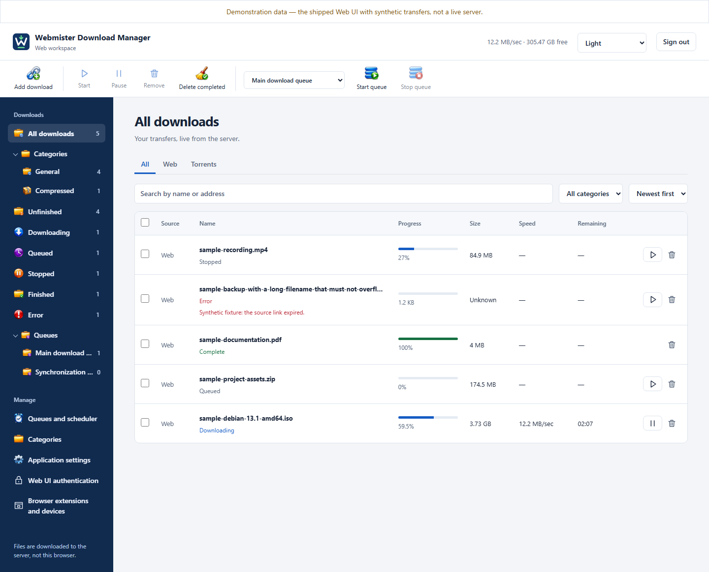
</picture>

*The actual shipped Web UI, captured with explicitly labeled demonstration transfers. These are not live downloads or speed benchmarks. No private account or server data is shown.*

<p align="center">
  <a href="https://github.com/mohamedyassine-benmiled/misterdownloadmanager-web/actions/workflows/web-image.yml"></a>
  <a href="LICENSE"></a>
</p>

| [Why Webmister](#why-webmister) | [Screenshots](#screenshots) | [Downloads](#downloads) | [Run with Compose](#run-with-docker-compose) | [Limitations](#status-and-limitations) |
| --- | --- | --- | --- | --- |

## Why Webmister?

**The familiar download manager. A server that does the work. A browser to control it.**

Run Webmister on your server, open its web workspace, and keep your downloads in one place.
The categories, toolbar, transfer list and progress dialogs are familiar MDM controls—not a
second desktop to stream or a native app to install on every browsing computer.

| Download on your server | Control it in your browser | Keep the MDM engine |
| --- | --- | --- |
| Files go to your server's storage. Closing the browser does not stop the server. | Add links, manage queues and inspect transfers from another device on your LAN/VPN. | Rust download engines, resumable transfers, torrents and compatible data formats underneath. |

Webmister adds the Web workspace, owner authentication, device pairing and deployment packaging
around MDM's existing application. Downloads are written to the **server**, not to the computer
running your browser. This is an evolving fork, [not full desktop/Web parity](#status-and-limitations).

## Screenshots

<table>
  <tr valign="top">
    <td width="50%"><br><sub><b>Your downloads, in one tab.</b> Categories, source filters and queue controls stay within reach.</sub></td>
    <td width="50%">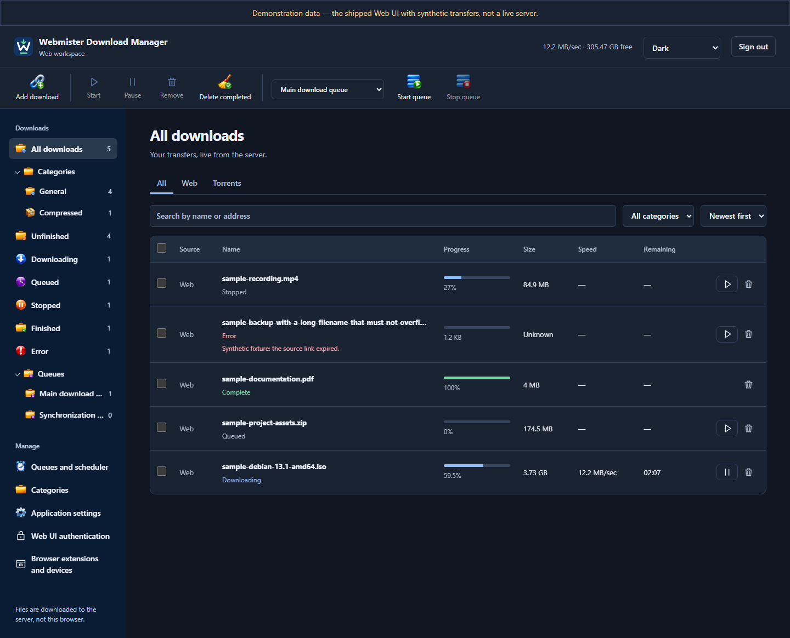<br><sub><b>Day or dark.</b> The same familiar workspace in either theme.</sub></td>
  </tr>
  <tr valign="top">
    <td>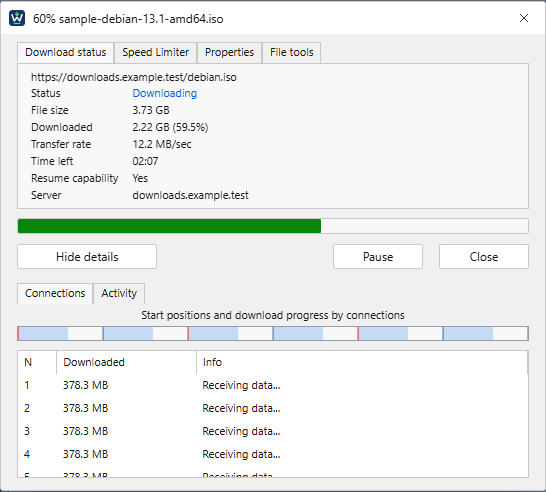<br><sub><b>Look inside a transfer.</b> Progress, connection details and file tools in a familiar dialog.</sub></td>
    <td>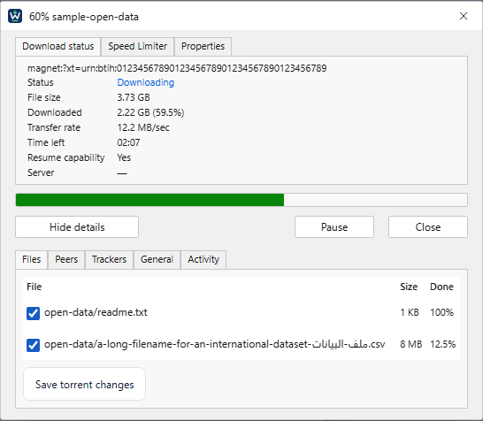<br><sub><b>Choose what to keep.</b> Torrent file selection and verification details after adding—not a pre-start picker.</sub></td>
  </tr>
  <tr valign="top">
    <td>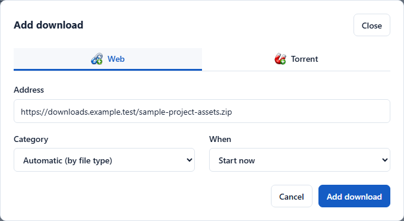<br><sub><b>Paste a link.</b> Choose a category and when to download it.</sub></td>
    <td>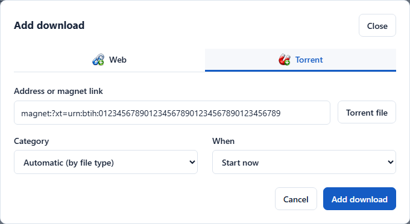<br><sub><b>Magnets and torrent files.</b> Add them from the same workspace.</sub></td>
  </tr>
  <tr valign="top">
    <td>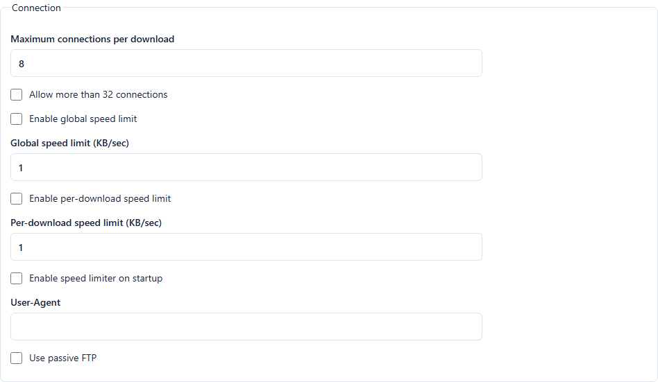<br><sub><b>Set the defaults.</b> Connection counts and speed-limit controls for the server.</sub></td>
    <td>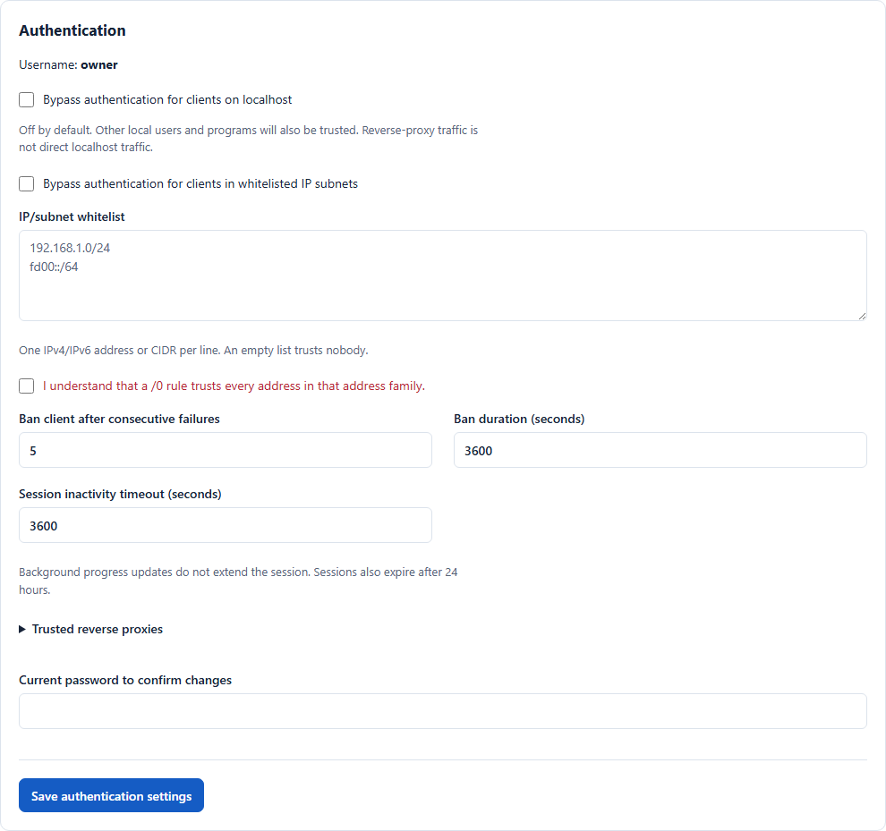<br><sub><b>Your server, your login.</b> Owner authentication and session policy, separate from extension devices.</sub></td>
  </tr>
  <tr valign="top">
    <td>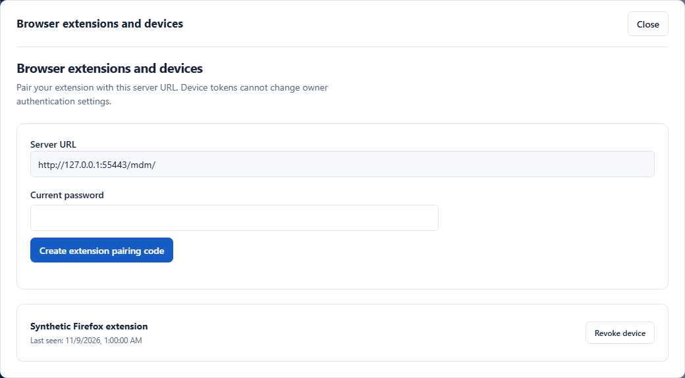<br><sub><b>Pair a browser.</b> Connect an extension without installing a native host on that computer.</sub></td>
    <td>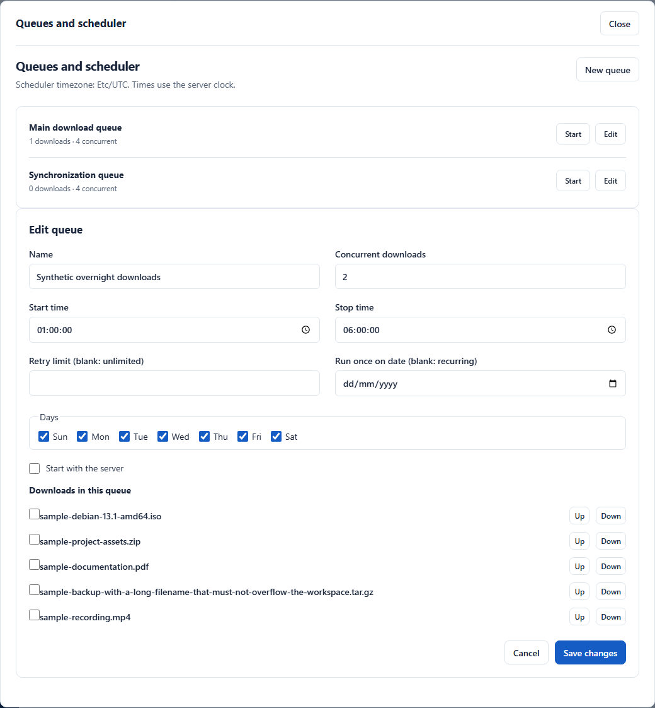<br><sub><b>Download on your schedule.</b> Set concurrency, days and start/stop times.</sub></td>
  </tr>
  <tr valign="top">
    <td align="center">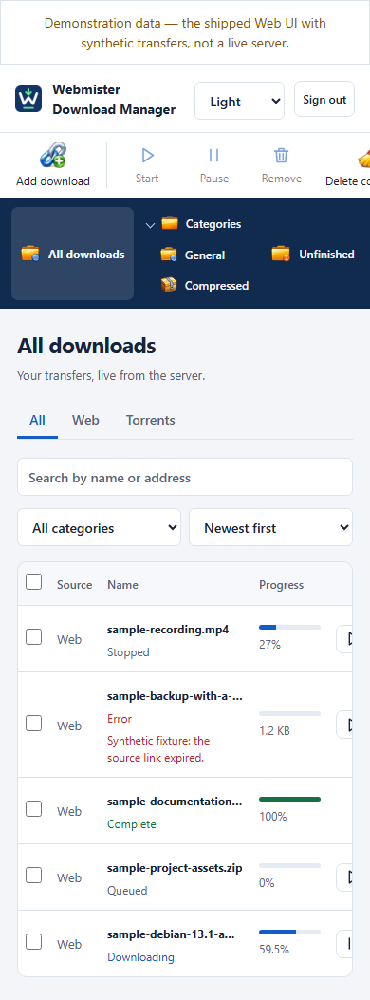<br><sub><b>Check in from your phone.</b> On narrow screens, the toolbar, navigation and transfer table scroll horizontally.</sub></td>
    <td>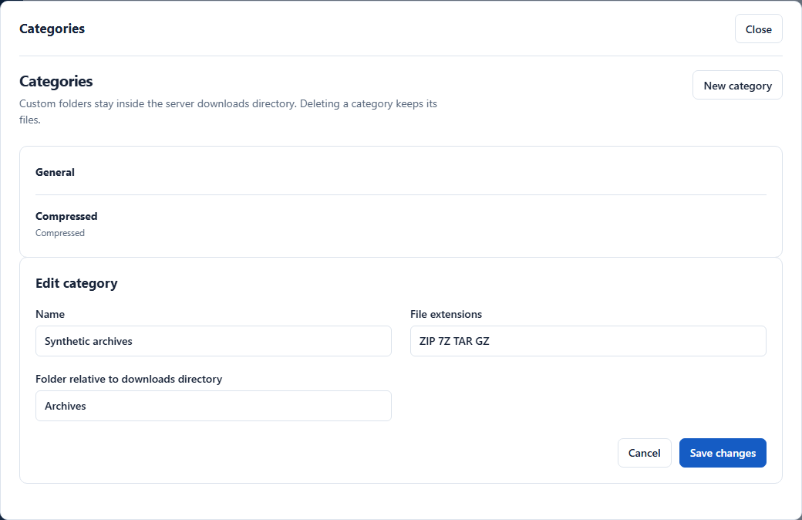<br><sub><b>Give files a place.</b> Manage categories and folders inside the server's downloads directory.</sub></td>
  </tr>
</table>

*All Web UI captures use synthetic demonstration data. They show shipped controls, not live
transfers, measured speeds or private server data.*

The screenshots and their source hashes are reproducible with [`tools/web/readme-shots.mjs`](tools/web/readme-shots.mjs). The original logo source is [`brand/webmister.svg`](brand/webmister.svg).

## What it does

- **Downloads on your server.** Run with `--web` without a desktop session; use the browser to
  add, start, pause, remove, search and filter transfers.
- **Uses MDM's download engines.** Multi-connection HTTP downloads and resumable transfers,
  with the existing engine and saved-state formats underneath.
- **Catches browser downloads remotely.** Pair the extension with your server; no native
  messaging host is needed on the browsing computer. If the server cannot accept a transfer,
  the browser keeps it. Browser-session downloads have [important limits](#browser-extension).
- **Handles torrents and magnets.** Add torrent files or magnet links, change file selection
  after adding, inspect peers and trackers, and request rechecking.
- **Connects to media automation apps.** An opt-in, experimental qBittorrent-compatible Web
  API lets Sonarr, Radarr and other compatible clients send torrents to Webmister and check
  their progress. A Sonarr download and import has been tested end to end; Radarr's connection
  test passed, but a Radarr download and import and other clients are not yet verified. This is
  not full qBittorrent API parity or a proven replacement. See the
  [compatibility notes and setup](docs/qbittorrent-compatibility.md).
- **Queues work for later.** Manage queue membership, concurrency and supported schedules;
  the server must stay running for the schedule to run.
- **Keeps file decisions explicit.** Review existing torrent files before verification/reuse;
  open an existing duplicate link or add a separately numbered copy.
- **Provides useful file tools.** Checksums, bounded move/rename and source replacement from
  the transfer details.
- **Separates owner access from device access.** Protected owner sessions, CSRF checks,
  authentication settings and revocable extension devices.
- **Feels familiar.** Category and queue trees, a persistent toolbar, light/dark themes and
  desktop-style progress dialogs, served as a Web UI.
- **Stays free and open source.** No ads, no trial, no cloud registration. You create a local
  owner account to administer your own server.

[Run with Compose](#run-with-docker-compose) · [Use the extension](#browser-extension) ·
[Run a native server](#run-without-docker) · [Web development](docs/web-development.md)

## The engine underneath: upstream's benchmark

**These are Mister Download Manager's upstream results, not a Webmister benchmark.**

Upstream compared MDM at commit `caa200c` with IDM 6.42 on 29 October 2026: the same Windows
computer, generated files from a local test server, seven runs per scenario, both programs at
their default settings. Its report records MDM finishing first in all seven scenarios.

| Selected upstream scenario | MDM median | IDM median |
| --- | --- | --- |
| 1 GiB over a fast local link | 1.009 s | 5.456 s |
| 100 MiB with 150 ms latency | 3.844 s | 7.622 s |
| 50 MiB with interrupted connections | 1.647 s | 5.428 s |

<p align="center">
  <picture>
    <source media="(prefers-color-scheme: dark)" srcset="docs/images/bench-time-dark.svg">
    
  </picture>
</p>

Source: [upstream benchmark report, machine and raw results](https://github.com/anefzaoui/misterdownloadmanager/blob/b35b42d4cab545fb63cba9765681ad4c7f67c4f2/docs/bench/run5/REPORT.md).
The report and harness are also preserved in [`docs/bench/run5/REPORT.md`](docs/bench/run5/REPORT.md)
and [`tools/bench`](tools/bench).

Webmister inherits MDM's engine, but these measurements were **not rerun against this fork,
its current engine revision, a container or a remote deployment**. Your server, disk, source
and network determine your speeds; this section is engine background, not a speed guarantee.

## Built on MDM, not on IDM

Webmister builds on MDM's open-source implementation; it is not a from-scratch engine of its
own. Upstream describes MDM as a clean-room implementation of a familiar workflow, built on
public standards—not a modification of Internet Download Manager.

The upstream and fork artwork retain their [attribution and license notices](ATTRIBUTION.md).
Neither Webmister nor MDM is affiliated with or endorsed by Tonec Inc. “Internet Download
Manager” and “IDM” are trademarks of their owner, named here only for the attributed comparison.

## Downloads

Use **this fork's [GitHub Releases](https://github.com/mohamedyassine-benmiled/misterdownloadmanager-web/releases)** and select a `web-vX.Y.Z` Webmister release—not the original project's downloads or extension-store listings.

| Release artifact | Purpose |
| --- | --- |
| `Webmister-X.Y.Z-windows-x86_64.zip` | Windows server bundle, `webmister.cmd` launcher and underlying MDM programs |
| `Webmister-X.Y.Z-linux-x86_64.tar.gz` | Linux x86-64 server bundle and `webmister` launcher; built on Ubuntu 22.04 |
| `Webmister-X.Y.Z-extension-chromium.zip` | Manual installation for Chromium-family browsers |
| `Webmister-X.Y.Z-extension-firefox.xpi` | **Unsigned** Firefox extension for temporary developer loading; normal installation requires Mozilla signing |
| `SHA256SUMS.txt` | SHA-256 hashes of the downloads and release metadata |
| `RELEASE.json` / `image-release.json` | Source commit, engine/fork versions, artifact inventory and published container digest |

Native bundles include both extension packages, the GPL license and upstream attribution. They are portable server archives, **not branded desktop installers**. Executables are not claimed to be code-signed; checksum files are not claimed to be signed attestations. Inspect the source and verify the download hashes.

The registry path stays tied to the existing repository:

```text
ghcr.io/mohamedyassine-benmiled/misterdownloadmanager-web
```

`latest` is the latest stable Webmister image; `edge` follows successful main-branch publications. Version tags and `sha-<full-commit>` tags are also produced. Pin the published `@sha256:…` digest for controlled deployments. Container support currently targets **linux/amd64**, not ARM.

> A successful Webmister publication is required before these downloads/image tags exist. If no `web-v*` release is available yet, use [Build from source](#build-from-source). This README does not claim an unpublished release is already downloadable.

## Run with Docker Compose

Requires Docker Engine and the Docker Compose plugin on a Linux host. Use a non-root host user with Docker access, or deliberately choose the non-root UID/GID that will own the mounted folders.

### 1. Create the folders

```sh
mkdir -p webmister/config webmister/downloads
cd webmister
chmod 700 config
printf 'MDM_UID=%s\nMDM_GID=%s\n' "$(id -u)" "$(id -g)" > .env
```

The configured UID/GID must own and be able to write both folders. Do not let Docker create root-owned bind mounts for you. Keep `config/` private: it contains the owner account, device state, settings and TLS material.

### 2. Save this as `compose.yml`

```yaml
services:
  webmister:
    image: ghcr.io/mohamedyassine-benmiled/misterdownloadmanager-web:latest
    restart: unless-stopped
    init: true
    user: "${MDM_UID:-1000}:${MDM_GID:-1000}"
    stop_grace_period: 60s
    ports:
      - "127.0.0.1:8463:8463"
    environment:
      MDM_DATA_DIR: /config
      MDM_DOWNLOADS: /downloads
      MDM_REMOTE_PORT: "8463"
      MDM_REMOTE_URL: http://localhost:8463/
      MDM_REMOTE_TLS: "0"
      MDM_REMOTE_HOSTS: localhost
      TZ: Etc/UTC
    volumes:
      - ./config:/config
      - ./downloads:/downloads
    security_opt:
      - no-new-privileges:true
    logging:
      driver: json-file
      options:
        max-size: "10m"
        max-file: "3"
```

A configurable standalone version is also provided at [`docker/compose.release.yml`](docker/compose.release.yml). It does not require a source checkout or a Rust toolchain.

### 3. Start and enroll the owner

```sh
docker compose config --quiet
docker compose pull
docker compose up -d
docker compose logs webmister
```

1. Open **http://localhost:8463/** on the Docker host. For a remote server, use an SSH tunnel: `ssh -L 8463:127.0.0.1:8463 user@server`.
2. HTTP is unencrypted: passwords, pairing codes and session tokens can be intercepted. Keep it on loopback or a trusted protected network. For built-in HTTPS, set `MDM_REMOTE_TLS=1` and set `MDM_REMOTE_URL` to the matching `https://` URL; verify the self-signed certificate's fingerprint before accepting it.
3. Use the one-time setup code in the logs to create the owner username/password. This is a server-local account, not a cloud registration.
4. Add a download or pair your browser extension. Files appear under the host's `downloads/` folder.

Get a fresh setup/pairing code when needed:

```sh
docker compose exec webmister misterdownloadmanager-cli pair
```

For access from another device, replace the published `127.0.0.1` with the Docker host's specific **LAN/VPN IP**, update `MDM_REMOTE_URL` to the URL clients will use, and add any DNS hostname to `MDM_REMOTE_HOSTS`. Use HTTPS or a protected tunnel; restrict access with the host firewall/VPN. Do not publish the port directly to the Internet. Leave the **container** listener automatic; its loopback is not the Docker host's loopback.

### Update or stop

Back up `config/` before upgrading; preserve `downloads/`. Then:

```sh
docker compose pull
docker compose up -d
# Clean stop; mounted files remain:
docker compose down
```

Check saved-state compatibility before downgrading. The image has an owner-credential-free healthcheck; Compose allows time for a clean stop and rotates logs. Pairing/setup codes in logs are sensitive—do not publish those logs.

## Browser extension

Use the **Webmister packages from the same release**, not the original project's store listings. No fork store publication or Firefox signing is implied.

1. **Chromium:** unzip `…-extension-chromium.zip`, open your browser's extensions page, enable Developer mode, choose **Load unpacked**, and select the folder containing `manifest.json`.
2. **Firefox:** open `about:debugging` → **This Firefox** → **Load Temporary Add-on** and select the unsigned XPI or its unpacked `manifest.json`. Temporary installation lasts until Firefox restarts. A normal persistent installation requires Mozilla signing, which this release pipeline does not perform.
3. Open your server's page in that same browser. If using built-in HTTPS, verify/trust its certificate.
4. In the Web UI, open **Browser extensions and devices**, generate a pairing code, then enter the server URL and code in the extension's **Another MDM** destination.

Remote mode does not need a native host. Revocation keeps the selected server destination and returns the transfer to the browser rather than silently switching to local MDM. Browser-session cookies, proxy credentials and POST bodies are not forwarded to the server; authenticated/browser-session downloads may need to stay in the browser.

The fork intentionally retains MDM's extension/protocol IDs for compatibility. Do not try to keep the official extension and this fork installed side-by-side under the same identity. Local/native behavior remains available, but server capture is the Webmister workflow described here.

## Run without Docker

Extract the matching server archive. The `webmister.cmd`/`webmister` launcher enables `--web` automatically; you can also run the underlying binary directly:

```sh
./misterdownloadmanager --web --port 8463 --webhost 127.0.0.1 \
  --data ./config --downloads ./downloads
```

On Windows, use `misterdownloadmanager.exe` or `webmister.cmd` with the same flags. The binary's desktop mode still uses upstream MDM names/artwork; these releases are intended to run as the headless server. There is no fork-native auto-updater: upgrade from this fork's releases manually rather than using the desktop's upstream updater.

| Parameter | Meaning |
| --- | --- |
| `--web` | Explicitly enable headless Web operation |
| `--port N` | HTTP or HTTPS port; default 8463 |
| `--webhost IP` | Local IP or adapter to bind, e.g. `127.0.0.1`, `[::1]` or a LAN address—not a public URL |
| `--data PATH` | Private, persistent configuration/account folder |
| `--downloads PATH` | Server download root |

Legacy `--headless` and `--listen` remain supported. Omit the host selection to use the existing local-network address selection; unspecified `0.0.0.0`/`::` bindings remain refused. See [server parameters and releases](docs/web-releases.md) and the [systemd examples](deploy/systemd/).

## Build from source

Use the Rust toolchain in `rust-toolchain.toml` (MSVC on Windows). The default engine's
browser-like TLS connection builds BoringSSL from source and additionally requires **CMake,
LLVM's libclang and NASM on Windows**; on Linux, install `cmake` and `libclang-dev`.
These prerequisites apply inside Docker's builder stage too; see the current build/release
validation limits below.

```sh
git clone https://github.com/mohamedyassine-benmiled/misterdownloadmanager-web.git
cd misterdownloadmanager-web
docker build -f docker/web.Dockerfile -t webmister:local .
```

Use `webmister:local` as the Compose image instead of GHCR. Or build natively using the toolchain in `rust-toolchain.toml`:

```sh
cargo build --locked --release -p mdm-app -p mdm-cli -p mdm-nmhost -p mdm-mcp
```

If you cannot build BoringSSL, `cargo build --locked --release -p mdm-app --no-default-features`
builds the app without the browser-like connection. This is a reduced-feature build, not
equivalent release validation; sites that reject MDM's normal connection may remain unavailable.

The build-from-checkout Compose file is [`docker/compose.yml`](docker/compose.yml); see [`docker/.env.example`](docker/.env.example). Developer tests and environment details are in [Web development](docs/web-development.md).

## Status and limitations

This is an evolving fork, **not 100% desktop/Web parity**. RSS, batch/link grabbing, import/export, advanced media/gallery workflows, accounts/secrets, extraction and broader settings still need work. See the [parity plan](docs/web-functional-parity-plan.md).

Use trusted LAN/VPN deployments for trials. Do not treat this as hardened public-Internet hosting or an unattended important-data service: outbound source/SSRF hardening, filesystem races and interrupted operations still require care. Existing torrent reuse can replace nonmatching data at the approved torrent paths; read its consent prompt.

Automated checks cover implemented browser, authentication, extension and real-headless flows. Full Linux/Compose/systemd acceptance, production proxy/certificate setups and real Firefox remote runtime are not all validated. Docker build/smoke and native release-binary checks must pass on GitHub before publication; configuration alone is not a successful release.

## Releases and upstream integration

The fork-owned **Webmister release** workflow prepares one `web-vX.Y.Z` release from one source commit: Windows/Linux archives, both extension packages, a tested Docker image, checksums and provenance metadata. Manual workflow runs are build-only. Missing required artifacts block publication; native builds do not silently become optional. Download checksums are provided without claiming upstream signing authority.

See [release operations](docs/web-releases.md) and the [upstream integration plan](docs/upstream-merge-plan.md). Fork-specific code stays in dedicated modules/workflows where practical, with small shared integration hooks. Upstream updates still require review and regression testing.

## Credits and license

Webmister builds on **[Mister Download Manager](https://github.com/anefzaoui/misterdownloadmanager)**, created by **Ahmed Nefzaoui and contributors**. The original application, download engines, translations and desktop artwork remain credited to their authors; see [ATTRIBUTION.md](ATTRIBUTION.md) and the source notices. The new Webmister name/mark identify this independent fork, not an endorsement by the upstream project.

Licensed under **[GPL-3.0-or-later](LICENSE)**. Source is available in this repository and at each release tag. Please report fork/Web issues [here](https://github.com/mohamedyassine-benmiled/misterdownloadmanager-web/issues), and support upstream development through its own project.

## Help Webmister grow

Found a rough edge? [Report it here](https://github.com/mohamedyassine-benmiled/misterdownloadmanager-web/issues).
Please leave passwords, pairing codes, device tokens and private download addresses out of reports.
For engine development and the original desktop application, visit
[Mister Download Manager](https://github.com/anefzaoui/misterdownloadmanager).

<p align="center">
  <a href="https://github.com/mohamedyassine-benmiled/misterdownloadmanager-web/stargazers"></a><br>
  <sub>If Webmister is useful, a star helps the next person find it.</sub>
</p>
